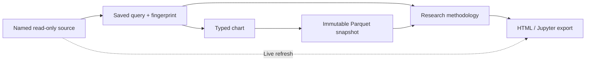

# Krisk documentation

Krisk has two independent entry points that can be combined when useful:

- **chart library:** pass Python data directly to Krisk in a notebook or script;
- **research server:** let an LLM investigate named read-only sources through MCP.

The chart library does not start a server or write to Krisk's metadata database. The
research server uses SQLite locally unless the operator explicitly configures shared
PostgreSQL metadata.

## Start here

| Goal | Guide |
| --- | --- |
| Make a chart from pandas or Ibis | [Typed charts](charts.md) |
| Try the complete local workflow | [End-to-end tutorial](tutorial.md) |
| Configure an LLM or API client | [MCP and REST](mcp-and-api.md) |
| Preserve a conclusion and monitor it | [Living research](living-research.md) |
| Understand data access and persistence | [Security and storage](security-and-storage.md) |

## Notebook tours

The repository notebooks are executable, server-free walkthroughs with repository-local
data and no undeclared visualization dependencies:

- [Quick start](../notebooks/Intro.ipynb)
- [Declarative visualization](../notebooks/declarative-visualization.ipynb)
- [Legends, titles, and toolbox controls](../notebooks/legend-title-toolbox.ipynb)
- [Reproducible charts and live refresh](../notebooks/resync-reproducible.ipynb)
- [Themes and colors](../notebooks/themes-colors.ipynb)
- [Tidy data plotting](../notebooks/tidy-plot.ipynb)
- [Waterfall and combination charts](../notebooks/waterfall-barline.ipynb)

## The data lifecycle

An export contains the historical snapshot. Live data is requested separately and is
never written over that evidence.

## Version status

The current version is `0.9.0`, an unpublished local-first beta. `1.0.0` has never
been published. The `1.0` implementation review remains in this repository as a record
of the pre-release audit and the reasoning behind the beta version.
